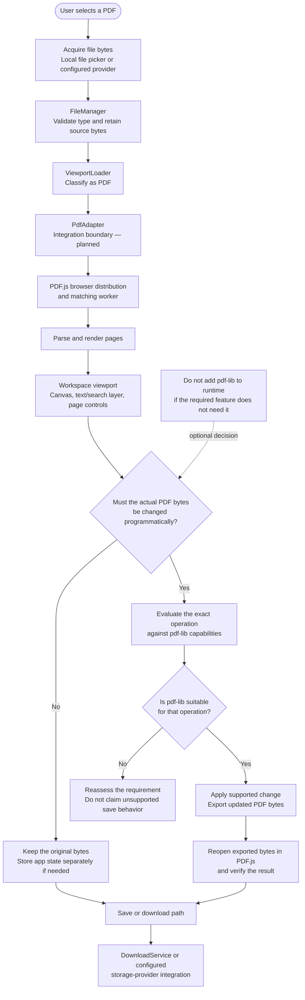
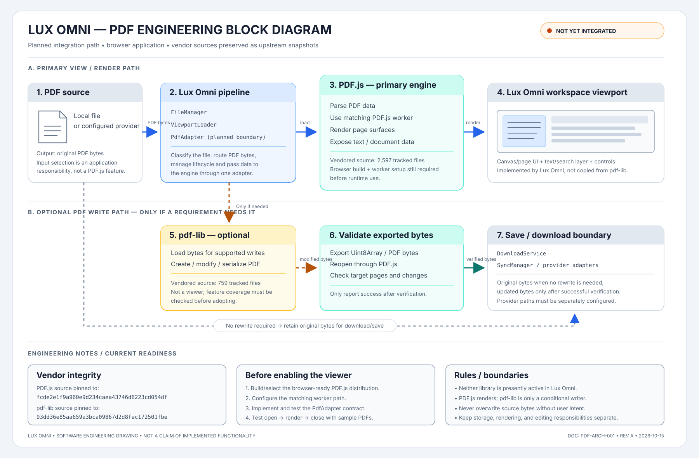

# Lux Omni PDF Workflow

> **Status: architecture plan only.** PDF.js and pdf-lib are vendored under `site/vendor/`, but neither is currently imported or used by Lux Omni. The application adapter files are placeholders. This diagram describes the intended flow, not implemented behavior.

## Flowchart

## Responsibilities

- **PDF.js first:** use its browser build and its matching worker for PDF parsing, page rendering, and viewing.
- **pdf-lib only when justified:** consider it for specific PDF creation/modification operations. It is not a PDF renderer, and it must not be assumed to support every editing feature.
- **Preserve source bytes:** loading a PDF for viewing should not silently overwrite the user's original document.
- **Verify writes:** whenever bytes are modified, reopen the exported document and test the required pages, annotations, forms, or content before presenting the save as successful.
- **Keep storage separate:** local download and cloud sync are separate integration responsibilities. Do not imply any provider is connected unless it has actually been configured and tested.

## Engineering block diagram

## Implementation gate

Before runtime integration, select the browser-ready PDF.js build, include the matching worker, define the `PdfAdapter` contract, and test one representative PDF from open through render. Only then decide whether any required write operation warrants pdf-lib.
